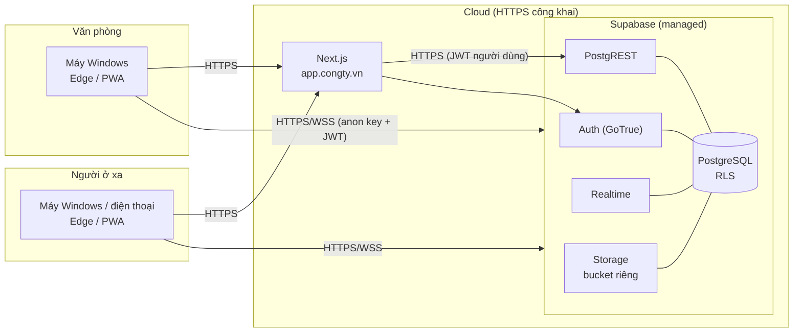
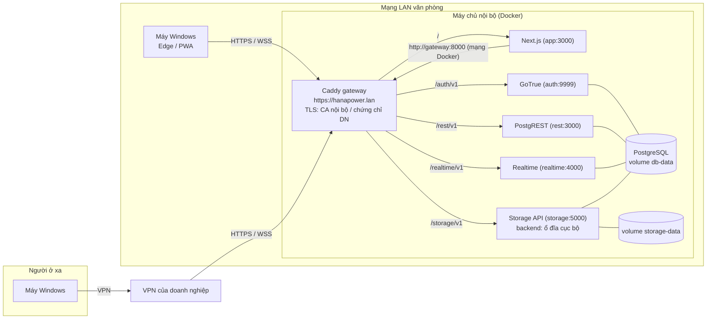

# Kiến trúc hệ thống

Ứng dụng quản trị công việc nội bộ: **một ứng dụng Next.js** (App Router, TypeScript strict) + **Supabase** (PostgreSQL, Auth, Realtime, Storage). Cùng một mã nguồn chạy được ở hai cấu hình triển khai; địa chỉ Supabase được đọc **lúc chạy** (`SUPABASE_PUBLIC_URL`, `SUPABASE_INTERNAL_URL`) nên một bản build dùng được cho cả hai.

## 1. Triển khai

### 1.1 Cloud



Mọi máy (trong văn phòng hay ở xa) dùng **cùng một địa chỉ HTTPS**. Khóa `service_role` chỉ nằm ở máy chủ Next.js.

### 1.2 Tại văn phòng (tự lưu trữ)



**Khi Internet văn phòng gián đoạn** nhưng LAN và máy chủ còn chạy, các chức năng cốt lõi vẫn hoạt động vì không thành phần nào cần Internet:

| Phụ thuộc | Cách xử lý trong cấu hình tại văn phòng | Đã xác minh |
|---|---|---|
| Đăng nhập | GoTrue tự lưu trữ, mật khẩu băm trong Postgres cục bộ; tắt đăng ký công khai và tắt gửi email (`GOTRUE_MAILER_AUTOCONFIRM`). Quên mật khẩu: quản trị viên đặt lại. | Có — xem `docs/progress.md` (kiểm thử trên mạng Docker `internal: true`, không có đường ra Internet) |
| Lưu tệp | storage-api với `STORAGE_BACKEND=file`, ghi vào volume cục bộ; không cần S3. | Có (tải lên/tải xuống trong mạng cô lập) |
| Realtime | supabase/realtime tự lưu trữ, tenant `realtime-dev`, JWT ký bằng `JWT_SECRET` cục bộ. | Có (kênh broadcast riêng tư trong mạng cô lập) |
| HTTPS | Caddy `tls internal` (CA nội bộ) hoặc chứng chỉ doanh nghiệp; `auto_https` không gọi ra Internet. | Có (HTTPS qua gateway) |
| Phông chữ, tài nguyên giao diện | Dùng phông hệ thống (Segoe UI), không tải Google Fonts/CDN lúc chạy. | Có (mã nguồn) |
| Ảnh Docker | Chỉ cần Internet khi **cài đặt/nâng cấp** (kéo ảnh). Có thể dùng registry nội bộ qua `IMAGE_REGISTRY`. | — |

## 2. Quan hệ dữ liệu

Mọi bảng nghiệp vụ có `org_id`; khóa ngoại ghép `(org_id, id)` khiến dự án, công việc, báo cáo **không thể** liên kết sang doanh nghiệp khác, kể cả khi ghi trực tiếp vào CSDL.

```mermaid
erDiagram
  organizations ||--o{ departments : "có"
  organizations ||--o{ profiles : "có"
  departments ||--o{ profiles : "thuộc"
  profiles ||--o| departments : "quản lý (manager_id)"
  profiles ||--o{ user_roles : "có vai trò"
  role_permissions }o--|| user_roles : "vai trò → quyền"
  organizations ||--o{ projects : "có"
  profiles ||--o{ projects : "quản lý (manager_id)"
  projects ||--o{ project_members : "thành viên"
  profiles ||--o{ project_members : "tham gia"
  projects ||--o{ tasks : "gồm"
  project_members ||--o{ tasks : "phụ trách (project_id, assignee_id)"
  tasks ||--o{ task_events : "lịch sử"
  tasks ||--o{ task_comments : "bình luận"
  profiles ||--o{ daily_reports : "viết (1/ngày)"
  daily_reports ||--o{ daily_report_items : "dòng"
  tasks ||--o{ daily_report_items : "được báo cáo"
  daily_reports ||--o{ task_events : "nguồn cập nhật"
  organizations ||--o{ audit_logs : "nhật ký"

  organizations { uuid id PK; text name; text timezone }
  profiles { uuid id PK "= auth.users.id"; uuid org_id FK; uuid department_id FK; bool is_active }
  user_roles { uuid user_id PK; app_role role PK; uuid org_id FK }
  projects { uuid id PK; uuid org_id FK; uuid manager_id FK; date start_date; date due_date; project_status status }
  project_members { uuid project_id PK; uuid user_id PK; text member_role }
  tasks { uuid id PK; uuid project_id FK; uuid assignee_id FK; task_status status; int progress "0-100"; numeric weight ">0"; bool is_blocked }
  daily_reports { uuid id PK; uuid user_id FK; date report_date "UNIQUE(user_id, report_date)"; report_status status }
  daily_report_items { uuid id PK; uuid report_id FK; uuid task_id FK; uuid project_id FK; int progress; text result; text blocker }
  task_events { bigint id PK; uuid task_id FK; text event_type; text source; uuid report_id FK }
  audit_logs { bigint id PK; uuid actor_id; text action; jsonb details }
```

Bảng sẽ thêm ở các giai đoạn sau: `weekly_reports` (bản chụp khi gửi), `notifications`, `conversations`, `conversation_members`, `messages`, `message_reads`, `task_attachments`.

### Quyền và phạm vi dữ liệu

- **Client chỉ được `SELECT`** (theo RLS). Mọi thao tác ghi đi qua hàm RPC `SECURITY DEFINER` kiểm tra quyền thao tác + phạm vi (doanh nghiệp, dự án, người phụ trách) rồi mới ghi, và ghi `audit_logs` cho đổi quyền, giao lại việc, duyệt/trả lại, sửa tiến độ.
- Hàm trợ giúp ở schema `app` (không lộ qua REST): `current_org_id()`, `has_permission()`, `can_view_project()`, `can_manage_project()`, `can_view_report_item()`…
- Vai trò mặc định: `system_admin`, `department_manager`, `project_manager`, `employee`. Danh mục quyền ở `role_permissions`. Quyền đọc chat riêng **không** nằm trong danh mục mà đi theo tư cách thành viên hội thoại (giai đoạn 5).
- Báo cáo ngày: chủ báo cáo xem cả bản nháp; quản lý phòng ban xem báo cáo đã gửi của nhân sự phòng mình; quản lý dự án **chỉ xem các dòng** thuộc dự án mình quản lý.

### Quy tắc tiến độ

- Tiến độ dự án = Σ(tiến độ × trọng số) / Σ trọng số, loại việc **Đã hủy**; trọng số mặc định 1, ràng buộc `> 0`.
- Không có việc hợp lệ → `NULL` → hiển thị “Chưa có dữ liệu tiến độ”.
- Báo 100% → **Chờ duyệt**. Số việc hoàn tất chỉ đếm việc **Hoàn tất** (đã duyệt). Ràng buộc CSDL: `in_review/done ⇒ progress = 100`, `done ⇒ approved_at NOT NULL`.
- Ngày “hôm nay”, quá hạn: theo `organizations.timezone` (mặc định `Asia/Ho_Chi_Minh`).

## 3. Luồng gửi báo cáo ngày

```mermaid
sequenceDiagram
  autonumber
  actor NV as Nhân viên (trình duyệt)
  participant UI as DailyReportForm (client)
  participant SA as Server Action submitDailyReport
  participant PG as PostgREST
  participant DB as PostgreSQL: submit_daily_report()

  NV->>UI: Soạn dòng (công việc, kết quả, tiến độ, vướng mắc)
  UI->>UI: Lưu nháp cục bộ (localStorage) mỗi lần thay đổi
  NV->>UI: Bấm "Gửi báo cáo" (nhấn hai lần bị chặn bởi cờ inFlight)
  UI->>SA: payload {report_date, note, items[]}
  SA->>SA: Kiểm tra zod
  SA->>PG: rpc('submit_daily_report') với JWT người dùng
  PG->>DB: BEGIN (một giao dịch)
  DB->>DB: INSERT daily_reports ON CONFLICT (user_id, report_date) DO NOTHING
  DB->>DB: SELECT … FOR UPDATE (tuần tự hóa các lần gửi đồng thời)
  alt Đã gửi trước đó
    DB-->>PG: {already_submitted: true, report_id, submitted_at} — không ghi gì thêm
  else Bản nháp
    DB->>DB: Thay dòng báo cáo; kiểm tra từng công việc thuộc người gửi
    loop Mỗi dòng
      DB->>DB: app.apply_progress(): cập nhật tasks (100% → Chờ duyệt), vướng mắc
      DB->>DB: INSERT task_events (source='daily_report', report_id)
      DB->>DB: Ghi progress_before / status_after vào dòng
    end
    DB->>DB: status='submitted', submitted_at=now()
    DB-->>PG: {already_submitted: false, …}
  end
  PG->>PG: COMMIT (lỗi bất kỳ → ROLLBACK toàn bộ)
  PG-->>SA: Kết quả
  SA-->>UI: ok + revalidate các trang
  UI->>UI: Xóa nháp cục bộ, router.refresh()
  Note over UI,SA: Mất mạng: UI giữ nội dung, hiện "Gửi lỗi", nút "Gửi lại".<br/>Gửi lại an toàn vì hàm idempotent theo (người dùng, ngày).
```

## 4. Tổ chức mã nguồn

```
src/
  app/
    dang-nhap/           Đăng nhập (server action)
    (app)/               Vùng đã đăng nhập: sidebar theo quyền
      page.tsx           Tổng quan
      viec-cua-toi/      Việc của tôi + cập nhật nhanh
      du-an/             Danh sách, chi tiết, Kanban, giao việc, duyệt/trả lại
      bao-cao/           Báo cáo ngày (nháp/gửi), báo cáo của nhân sự
      tro-chuyen/        (giai đoạn 5)
      nhan-su/           Vai trò, khóa tài khoản (quản trị)
      cai-dat/           Tài khoản, đổi mật khẩu
    manifest.ts          Manifest PWA
  components/ui/         Thành phần kiểu shadcn/ui (Button, Card, Input…)
  lib/                   env (cấu hình runtime), supabase (server/browser/middleware), auth, queries, progress, labels
supabase/
  migrations/            Migration SQL có phiên bản (tương thích Supabase CLI)
  seed.sql               Dữ liệu mẫu
deploy/onprem/           docker compose + Caddy cho cấu hình tại văn phòng
scripts/                 migrate.mjs, bootstrap-org.mjs, gen-onprem-env.mjs, *.ps1
tests/unit | db | e2e    Vitest (thuần), Vitest + Postgres thật (RLS/RPC), Playwright
```
