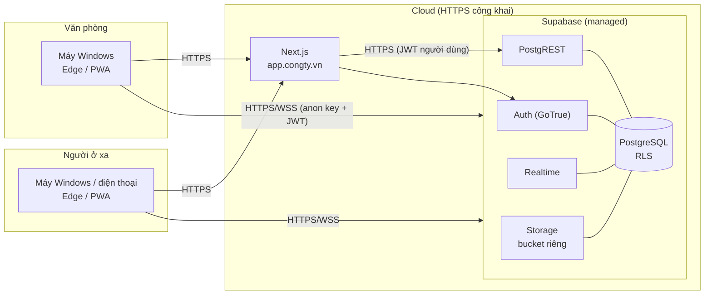
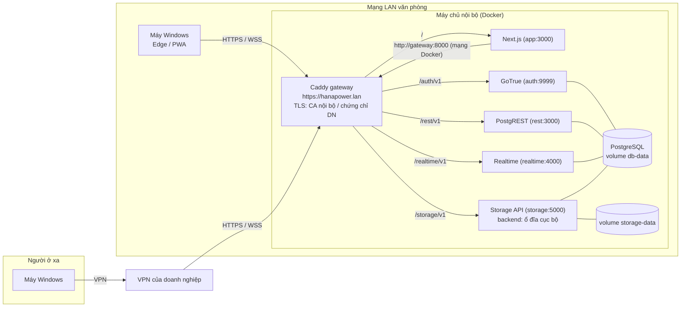
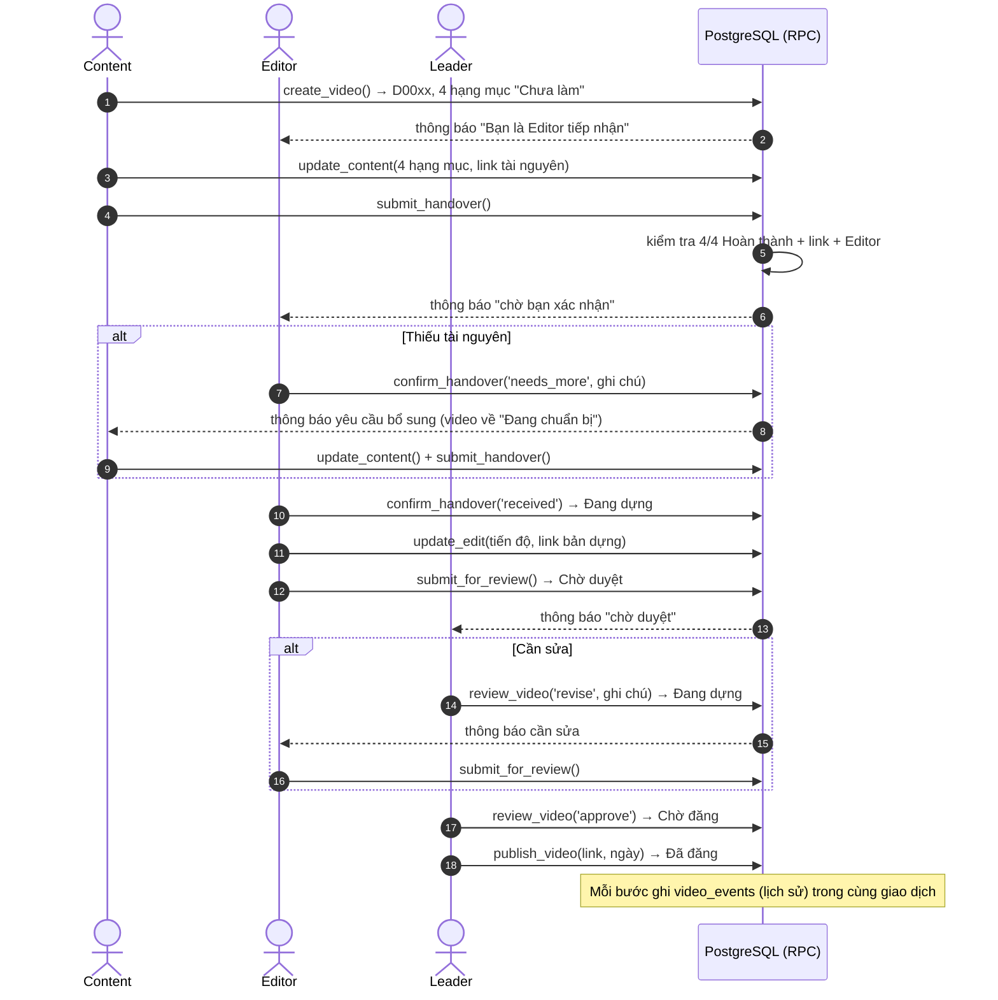

# Kiến trúc hệ thống

Ứng dụng quản lý sản xuất video của HANA MEDIA: **một ứng dụng Next.js** (App Router, TypeScript strict) + **Supabase** (PostgreSQL, Auth, Realtime, Storage). Cùng một mã nguồn chạy được ở hai cấu hình triển khai; địa chỉ Supabase được đọc **lúc chạy** (`SUPABASE_PUBLIC_URL`, `SUPABASE_INTERNAL_URL`) nên một bản build dùng được cho cả hai.

## 1. Triển khai

### 1.1 Cloud



Mọi máy (trong văn phòng hay ở xa) dùng **cùng một địa chỉ HTTPS**. Khóa `service_role` chỉ nằm ở máy chủ Next.js.

### 1.2 Tại văn phòng (tự lưu trữ)



**Khi Internet văn phòng gián đoạn** nhưng LAN và máy chủ còn chạy, các chức năng cốt lõi vẫn hoạt động vì không thành phần nào cần Internet:

| Phụ thuộc | Cách xử lý trong cấu hình tại văn phòng | Đã xác minh |
|---|---|---|
| Đăng nhập | GoTrue tự lưu trữ, mật khẩu băm trong Postgres cục bộ; tắt đăng ký công khai và tắt gửi email (`GOTRUE_MAILER_AUTOCONFIRM`). Quên mật khẩu: quản trị viên đặt lại. | Có — xem `docs/progress.md` (kiểm thử trên mạng Docker `internal: true`, không có đường ra Internet) |
| Lưu tệp | storage-api với `STORAGE_BACKEND=file`, ghi vào volume cục bộ; không cần S3. | Có (tải lên/tải xuống trong mạng cô lập) |
| Realtime | supabase/realtime tự lưu trữ, tenant `realtime-dev`, JWT ký bằng `JWT_SECRET` cục bộ. | Có (kênh broadcast riêng tư trong mạng cô lập) |
| HTTPS | Caddy `tls internal` (CA nội bộ) hoặc chứng chỉ doanh nghiệp; `auto_https` không gọi ra Internet. | Có (HTTPS qua gateway) |
| Phông chữ, tài nguyên giao diện | Dùng phông hệ thống (Segoe UI), không tải Google Fonts/CDN lúc chạy. | Có (mã nguồn) |
| Ảnh Docker | Chỉ cần Internet khi **cài đặt/nâng cấp** (kéo ảnh). Có thể dùng registry nội bộ qua `IMAGE_REGISTRY`. | — |

## 2. Quan hệ dữ liệu

Mọi bảng nghiệp vụ có `org_id`; khóa ngoại ghép `(org_id, id)` khiến video, người phụ trách, kênh **không thể** liên kết sang doanh nghiệp khác, kể cả khi ghi trực tiếp vào CSDL.

```mermaid
erDiagram
  organizations ||--o{ profiles : "nhân sự"
  organizations ||--o{ departments : "bộ phận"
  profiles ||--o{ user_roles : "vai trò"
  role_permissions }o--|| user_roles : "vai trò → quyền"
  organizations ||--o{ channels : "kênh"
  organizations ||--|| org_counters : "đếm mã D0001…"
  organizations ||--o{ videos : "video"
  channels ||--o{ videos : "phát hành"
  profiles ||--o{ videos : "Content phụ trách"
  profiles ||--o{ videos : "Editor tiếp nhận"
  videos ||--|{ video_items : "4 hạng mục"
  videos ||--o{ video_events : "lịch sử"
  videos ||--o{ video_comments : "trao đổi"
  videos ||--o{ notifications : "thông báo"
  profiles ||--o{ notifications : "người nhận"
  organizations ||--o{ audit_logs : "nhật ký"

  videos { uuid id PK; text code "D0001 (UNIQUE theo org)"; text title; video_stage stage; date report_date "Ngày báo cáo"; date due_date "Hạn đăng"; uuid content_owner_id FK; uuid editor_id FK; text resource_url "Link tài nguyên"; handover_status handover_status "Xác nhận bàn giao"; timestamptz handover_confirmed_at "Ngày xác nhận"; text editor_note "Ghi chú Edit"; int supplement_count; int edit_progress; text draft_url; int revision_count; text published_url; date published_at }
  video_items { uuid video_id PK; text kind PK "real_footage | ai_video | script_vo | edit_map"; item_status status "Chưa làm | Đang làm | Hoàn thành" }
  video_events { bigint id PK; text event_type; video_stage from_stage; video_stage to_stage; text note }
  notifications { bigint id PK; uuid user_id FK; text kind; text message; timestamptz read_at }
  channels { uuid id PK; text name; text platform; text url }
```

### Đối chiếu với Google Sheet cũ

| Cột trong sheet | Trong ứng dụng |
|---|---|
| STT, Ngày báo cáo, Mã dự án | Số thứ tự trong bảng, `report_date`, `code` (tự cấp) |
| Tên dự án / video, Content phụ trách | `title`, `content_owner_id` |
| Nguồn thật, Video AI, Kịch bản / VO, Sơ đồ dựng | `video_items` (Chưa làm / Đang làm / Hoàn thành) |
| Link tài nguyên, Ghi chú Content | `resource_url`, `content_note` |
| Trạng thái Content (Đang triển khai / Chờ bàn giao / Đã bàn giao) | suy ra từ `stage` — không thể lệch với xác nhận của Editor |
| Editor tiếp nhận, Xác nhận bàn giao, Ngày xác nhận, Ghi chú Edit | `editor_id`, `handover_status`, `handover_confirmed_at`, `editor_note` |
| (mới) | Đang dựng, link bản dựng, duyệt / yêu cầu sửa, đăng kênh, số lần bổ sung / sửa, lịch sử, thông báo |
| Tab theo tháng | Bộ lọc tháng + trang Báo cáo tháng + xuất CSV cùng cột |

### Vai trò và quyền

| Vai trò | Quyền chính |
|---|---|
| Quản trị hệ thống | Vai trò, khóa tài khoản, nhật ký, kênh |
| Leader (`manager`) | Tạo & phân công video, sửa mọi bước, duyệt / yêu cầu sửa, ghi nhận đăng, tạm dừng / hủy, kênh, báo cáo |
| Content | Tự tạo video (mình phụ trách), cập nhật 4 hạng mục + link, chọn Editor, bàn giao — chỉ video của mình, chỉ trước khi bàn giao |
| Editor | Xác nhận / yêu cầu bổ sung, tiến độ dựng, nộp duyệt — chỉ video mình được giao |

- **Client chỉ được `SELECT`** (RLS). Mọi thao tác đi qua hàm RPC `SECURITY DEFINER`: kiểm tra vai trò, phân công và **đúng bước** rồi mới ghi; ghi `video_events`, gửi `notifications`, ghi `audit_logs` cho phân công lại, duyệt, yêu cầu sửa, đăng, hủy, đổi vai trò.
- Cả đội trong công ty xem được bảng video (như Google Sheet chung); thông báo chỉ người nhận xem được.

### Quy tắc chuyển bước (thực thi trong CSDL)

- Bàn giao chỉ khi **cả 4 hạng mục Hoàn thành + có link tài nguyên + đã chọn Editor**. Sau khi bàn giao, Content không sửa được phần Content nữa.
- **Yêu cầu bổ sung** và **yêu cầu sửa** bắt buộc ghi chú; video quay về bước trước, bộ đếm `supplement_count` / `revision_count` tăng.
- Ràng buộc: `Đang dựng/Chờ duyệt/Chờ đăng/Đã đăng ⇒ handover_status = Đã nhận đủ`; `Chờ đăng/Đã đăng ⇒ đã duyệt`; `Đã đăng ⇒ có link và ngày đăng`.
- Gửi lặp (nhấn hai lần, mạng chập chờn) ở bàn giao / xác nhận / nộp duyệt / duyệt / đăng không tạo bản ghi trùng. Khóa dòng `FOR UPDATE` tuần tự hóa thao tác đồng thời; mã video cấp bằng bộ đếm có khóa nên không trùng.

## 3. Luồng bàn giao Content → Editor → Leader



## 4. Tổ chức mã nguồn

```
src/
  app/
    dang-nhap/            Đăng nhập
    (app)/                Vùng đã đăng nhập: sidebar theo quyền
      page.tsx            Tổng quan: việc cần làm của tôi, dây chuyền, chỉ số tháng, quá hạn
      video/              Bảng video (như sheet) / Kanban, tạo video, chi tiết video theo bước
      bao-cao/            Báo cáo tháng + xuat/ (CSV)
      thong-bao/          Thông báo
      tro-chuyen/         (giai đoạn sau)
      nhan-su/            Vai trò, khóa tài khoản
      cai-dat/            Tài khoản, kênh phát hành, đổi mật khẩu
  components/             video-workspace (các bước), video-table, ui/ (kiểu shadcn)
  lib/                    env, supabase, auth, queries, pipeline (quy tắc thuần), labels
supabase/migrations/      0100 nền tảng + 0200 quy trình sản xuất video
tests/unit | db | e2e     Vitest, Vitest + Postgres thật, Playwright
```
