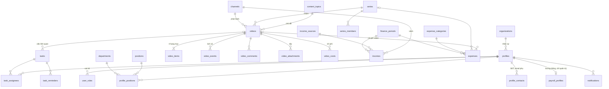
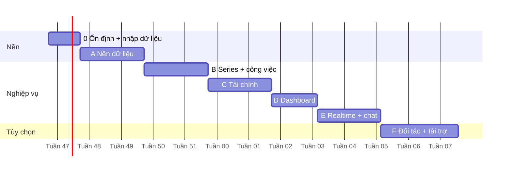

# Lộ trình phát triển HANA Studio theo mô hình CRM Apollo

Tài liệu đối chiếu hệ thống tham chiếu **CRM Apollo** (51 bảng, 26 enum, 5 vai trò, chạy cho agency) với **HANA Studio** (quản lý sản xuất video của HANA MEDIA), rồi đề xuất thứ tự phát triển.

> Số tuần dưới đây là **ước lượng thô** cho một người làm cùng trợ lý AI, chưa tính thời gian bạn kiểm tra và phản hồi. Phần nào phụ thuộc vào cách HANA MEDIA kinh doanh được đánh dấu **[cần xác nhận]**.

---

## 1. Hiện trạng so với CRM Apollo

| Nhóm | CRM Apollo | HANA Studio hiện có |
|---|---|---|
| Xác thực | JWT + refresh token, quên mật khẩu qua email (SES), bị khóa thì đăng xuất ngay | Supabase Auth; quản trị đặt lại mật khẩu; khóa tài khoản có hiệu lực ngay (RLS kiểm tra `is_active` mỗi yêu cầu) |
| Vai trò | 5: super_admin, admin, team_lead, staff, collaborator | 4: quản trị, Leader, Content, Editor |
| Nhân sự | Hồ sơ đầy đủ, phòng ban, chức vụ, nhiều SĐT/email, lương/bảo hiểm | Họ tên, email, chức danh, bộ phận |
| Dự án | Dự án có ngân sách, tiến độ, rủi ro, thành viên, mốc thanh toán | **Chưa có** (đơn vị là từng video) |
| Tài chính | Thu/chi theo tháng, danh mục, nguồn thu, gắn dự án/phòng ban | **Chưa có** |
| Công việc | Task có loại, nhắc việc, giao nhiều người, tệp đính kèm | Chỉ có quy trình video; chưa có việc lẻ và nhắc việc |
| Bán hàng | Lead → Cơ hội → Báo giá → Hợp đồng → Đơn hàng | **Chưa có** |
| Dashboard | KPI, pipeline, doanh thu, thu/chi, biểu đồ | Thẻ chỉ số và danh sách, chưa có biểu đồ |
| Tệp | Tải lên S3 (ảnh, đính kèm) | Chỉ lưu link Google Drive |
| Realtime | Socket.IO báo mọi thay đổi | Làm mới khi tải trang |
| Dữ liệu | Xóa mềm, người tạo/sửa, phân trang/tìm kiếm | Nhật ký thao tác; chưa xóa mềm; chưa phân trang phía máy chủ |
| Khác | Song ngữ Việt/Anh, xuất Excel, PDF báo giá | Tiếng Việt, xuất CSV |

## 2. Giữ công nghệ hiện tại, không chuyển sang bộ của CRM

| CRM Apollo | HANA Studio | Lý do giữ |
|---|---|---|
| Express + Drizzle + PostgreSQL | Next.js + Supabase (PostgreSQL) | Cùng là PostgreSQL. Phân quyền theo hàng dữ liệu (RLS) làm thay phần "lọc dữ liệu theo vai trò trong service". Chuyển sang là làm lại từ đầu mà không được thêm tính năng nào |
| Socket.IO | Supabase Realtime | Đã chạy thử được; không phải tự dựng máy chủ socket |
| AWS S3 | Supabase Storage (bucket riêng) | Cùng một hệ thống đăng nhập và phân quyền |
| AWS SES | Supabase Auth + SMTP (Resend/SES) | Chỉ cần cấu hình |
| MUI + React Query | shadcn/ui + Server Components | Đã làm xong giao diện, responsive |
| Recharts, ExcelJS, i18next | **Dùng lại** | Thư viện độc lập, thêm được ngay |

## 3. Nên lấy gì, bỏ gì

| Module CRM | Quyết định | Ghi chú |
|---|---|---|
| Phân quyền thêm `team_lead`, `collaborator` | **Lấy** | Trưởng nhóm Content/Edit; cộng tác viên làm thuê chỉ xem việc của mình |
| Phòng ban, chức vụ, hồ sơ nhân sự | **Lấy** | Có sẵn một phần |
| Lương, bảo hiểm, thuế TNCN | **Chỉ lấy nếu tính lương trong app [cần xác nhận]** | Dữ liệu nhạy cảm: bảng riêng, chỉ quản trị đọc |
| Danh mục dùng chung | **Lấy** | Chủ đề video, nguồn thu, danh mục chi |
| Dự án | **Lấy, đổi thành "Series / Chiến dịch"** | Nhóm nhiều video (vd. "Săn mồi châu Phi"), có ngân sách và tiến độ tính từ video |
| Tài chính thu/chi | **Lấy** | Thu AdSense/tài trợ, chi AI/giọng đọc/cộng tác viên; tính chi phí mỗi video và lãi mỗi kênh |
| Task, nhắc việc | **Lấy** | Việc lẻ ngoài quy trình video (họp, hẹn), nhắc tới hạn |
| Dashboard biểu đồ | **Lấy** | Năng suất theo người, thời gian ở mỗi bước, thu/chi theo kênh |
| Xóa mềm, người tạo/sửa | **Lấy** | Làm trước vì đổi sau rất khó |
| Lead, Cơ hội, Báo giá, Hợp đồng, Đơn hàng, Sản phẩm, Bảng giá | **Bỏ, trừ khi nhận làm video thuê cho khách [cần xác nhận]** | Nếu chỉ chạy kênh của chính mình thì không có "khách hàng" để quản lý. Nếu có tài trợ/hợp đồng, dùng bản nhẹ ở Giai đoạn F |
| Song ngữ Việt/Anh | **Hoãn** | Cả đội dùng tiếng Việt |
| PDF báo giá | **Bỏ** | Gắn với module bán hàng |

## 4. Những lỗi thiết kế của CRM nên tránh

Phần "Lưu ý về schema" trong tài liệu CRM chỉ ra các chỗ nên làm khác:

1. **Cột `created_by` vừa NOT NULL vừa `ON DELETE SET NULL`:** mâu thuẫn, xóa người dùng là lỗi. HANA Studio cho phép NULL và dùng **khóa tài khoản + xóa mềm** thay vì xóa cứng.
2. **Báo giá/hợp đồng lấy số liệu sống từ cơ hội:** đổi sản phẩm là số trên hợp đồng cũ đổi theo. Với HANA Studio: **chụp lại số liệu tại thời điểm chốt**, áp dụng cho chi phí video đã đăng và hợp đồng tài trợ.
3. **Đặt tên lệch** (`finnance`, `create_by`): đặt quy ước một lần, kiểm tra bằng test.
4. **Phát sự kiện `data:changed` cho mọi lần ghi:** tốn băng thông khi đông người. Ta chỉ đăng ký thay đổi ở bảng cần thiết (video, thông báo).
5. **Chưa nói rõ phân trang:** làm phân trang phía máy chủ ngay từ Giai đoạn A, trước khi dữ liệu lớn.

## 5. Mô hình dữ liệu đích

Bảng **đậm** là bảng sẽ thêm; còn lại đã có.

Bảng mới: `positions`, `profile_positions`, `profile_contacts`, `payroll_profiles`, `series`, `series_members`, `content_topics`, `video_attachments`, `video_costs`, `finance_periods`, `incomes`, `expenses`, `income_sources`, `expense_categories`, `tasks`, `task_assignees`, `task_reminders`.
Cột chung thêm vào mọi bảng nghiệp vụ: `deleted_at`, `created_by`, `updated_by`, `created_at`, `updated_at`.

## 6. Lộ trình theo giai đoạn

### Giai đoạn 0 — Chạy ổn định trên cloud (đang làm, 1 tuần)
- Merge, chạy tạo bảng, khởi tạo, tạo tài khoản, nhập dữ liệu từ Google Sheet.
- Đo tốc độ sau khi chuyển Vercel sang Singapore.
- **Xong khi:** cả đội đăng nhập và làm việc hằng ngày trên app, không cần Google Sheet nữa.

### Giai đoạn A — Nền dữ liệu (1–2 tuần)
- Xóa mềm + người tạo/sửa tự động cho mọi bảng; sao lưu hằng ngày (Supabase Pro).
- Thêm vai trò `team_lead` và `collaborator`; trưởng nhóm thấy và duyệt trong phòng mình.
- `positions`, nhiều chức vụ/phòng ban cho một người; hồ sơ nhân sự đầy đủ (mã NV, SĐT, email cá nhân, ngày vào làm, hình thức làm việc).
- Danh mục: chủ đề video, nguồn thu, danh mục chi (có màn hình quản lý).
- Phân trang, tìm kiếm, sắp xếp phía máy chủ cho Video, Nhân sự, Thông báo.
- Tệp đính kèm video lên Supabase Storage (bucket riêng, kiểm tra quyền theo video).
- Quên mật khẩu qua email.
- **Xong khi:** xóa một video có thể khôi phục; trưởng nhóm không thấy phòng khác; danh sách 5.000 video vẫn mở dưới 2 giây.

### Giai đoạn B — Series và công việc lẻ (2 tuần)
- **Series/Chiến dịch:** gom video, ngân sách, hạn, thành viên, tiến độ tính từ trạng thái các video, mức rủi ro.
- **Công việc lẻ:** họp, hẹn, nhắc việc; giao nhiều người; nhắc trước N phút (cron trên Supabase/Vercel) → thông báo trong app.
- Liên kết việc lẻ với video.
- **Xong khi:** thấy mỗi series xong bao nhiêu phần trăm và ai đang nghẽn; việc đến hạn tự nhắc.

### Giai đoạn C — Tài chính (2 tuần) [cần xác nhận]
- Kỳ tài chính theo tháng; thu theo kênh/nguồn; chi theo danh mục, series, video, người phụ trách.
- **Chi phí mỗi video** (AI, giọng đọc, cộng tác viên); chụp lại khi video đã đăng để số liệu cũ không đổi.
- Hóa đơn/chứng từ đính kèm; nhập thu từ Excel/CSV của YouTube.
- Quyền xem tài chính chỉ cho quản trị và Leader.
- **Xong khi:** báo cáo tháng cho thấy thu, chi, lãi từng kênh và chi phí trung bình mỗi video.

### Giai đoạn D — Dashboard và báo cáo nâng cao (1–2 tuần)
- Biểu đồ: số video theo tuần, thời gian trung bình ở mỗi bước (lấy từ lịch sử), tỷ lệ bổ sung/sửa, năng suất theo người, thu/chi theo kênh.
- Cảnh báo video kẹt quá N ngày ở một bước.
- Xuất Excel `.xlsx` (thay cho CSV).
- **Xong khi:** Leader nhìn một trang là biết khâu nào đang chậm.

### Giai đoạn E — Realtime và trò chuyện (2 tuần)
- Danh sách video và thông báo cập nhật ngay không cần tải lại (Supabase Realtime).
- Chat riêng, nhóm, kênh theo series; đánh dấu đã đọc; tin nhắn lưu vào database trước khi báo thành công.
- PWA ngoại tuyến cơ bản (service worker).
- **Xong khi:** Editor bàn giao xong, Content thấy thông báo trong vài giây.

### Giai đoạn F — Đối tác và tài trợ (tùy chọn, 2–3 tuần) [cần xác nhận]
Chỉ làm nếu HANA MEDIA nhận làm video thuê hoặc có tài trợ:
- Bản nhẹ của CRM: **Đối tác** (công ty, người liên hệ), **Cơ hội** có giai đoạn (trao đổi → báo giá → ký → thực hiện), **Hợp đồng** gắn series, **mốc thanh toán** tự sinh khoản thu khi đã trả.
- Không làm bảng giá, sản phẩm, đơn hàng.
- **Xong khi:** một hợp đồng tài trợ đi từ trao đổi đến thu tiền mà không cần Excel.

## 7. Thứ tự đề xuất

Giai đoạn B và C có thể đổi chỗ nếu tiền bạc cấp bách hơn tiến độ. Giai đoạn D nên làm sau C để biểu đồ có số liệu thu/chi.

## 8. Rủi ro và cách xử lý

| Rủi ro | Cách xử lý |
|---|---|
| Làm quá nhiều trước khi đội dùng thật | Mỗi giai đoạn kết thúc bằng một tuần cả đội dùng thử và góp ý |
| Dữ liệu nhạy cảm (lương, doanh thu) lộ | Bảng riêng, RLS chặt, kiểm thử "bị từ chối" cho từng vai trò (giống bộ kiểm thử hiện có) |
| Supabase Free tạm dừng, không sao lưu | Nâng Supabase Pro trước khi nhập dữ liệu thật quan trọng |
| Migration sai làm hỏng dữ liệu cloud | Mỗi migration chạy thử trên bản sao; có sao lưu trước; không bao giờ `--reset` trên cloud (script đã chặn) |
| Chậm khi dữ liệu tăng | Phân trang phía máy chủ, chỉ mục, đo thời gian mỗi trang |
| Phụ thuộc người duy nhất giữ mật khẩu quản trị | Tạo ít nhất 2 tài khoản quản trị |

## 9. Câu hỏi cần bạn trả lời trước khi bắt đầu

1. **HANA MEDIA kiếm tiền bằng cách nào?** Chỉ YouTube AdSense của kênh riêng, hay còn nhận tài trợ, làm video thuê cho khách? → Quyết định có làm Giai đoạn F không.
2. **Có cần theo dõi thu chi trong app không?** Nếu đang dùng phần mềm kế toán riêng thì có thể hoãn Giai đoạn C.
3. **Có tính lương trong app không?** Nếu không, bỏ hẳn bảng lương và bảo hiểm.
4. **Đội hiện có bao nhiêu người, dự kiến bao nhiêu trong 6 tháng tới?** Ảnh hưởng đến gói Supabase/Vercel nên chọn.
5. **Có cộng tác viên làm thuê (freelancer) không?** Nếu có, làm vai trò `collaborator` ngay ở Giai đoạn A.
